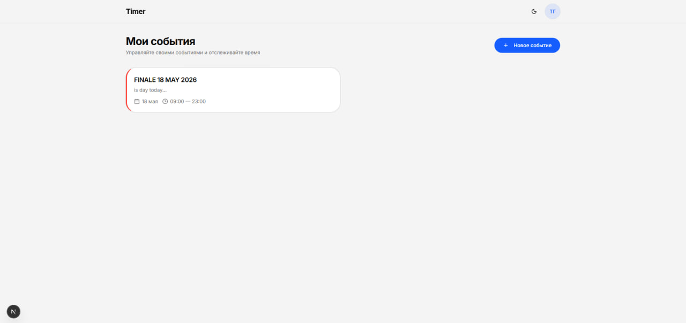

# Timer — личный трекер событий

<p align="center">
  Приложение для отслеживания личных событий и обратного отсчёта до важных дат.
  Все события видны только владельцу аккаунта.
</p>

---

## Возможности

- 🔐 **Личный аккаунт** — регистрация и вход, пароли через bcrypt, сессии в JWT
- 📅 **События** — название, описание, дата, время, часовой пояс, цвет, категория, эмодзи
- ⏱️ **Обратный отсчёт** — анимированные цифры, корректная работа с часовыми поясами
- 🌗 **Тёмная и светлая тема** — переключение в один клик
- 📱 **Адаптивный интерфейс** — mobile-first, touch targets 44px+
- 🧱 **Server-first архитектура** — Server Components, Server Actions, zod-валидация
- ✅ **Проверки** — ESLint, TypeScript, Vitest, GitHub Actions

## Скриншоты

### Дашборд

<p align="center">
  
</p>

### Таймер события

<p align="center">
  
</p>

## Стек

| Категория | Технологии |
|-----------|-----------|
| **Framework** | Next.js 16 (App Router, Turbopack) |
| **Language** | TypeScript |
| **Styling** | Tailwind CSS v4 + shadcn/ui на Base UI |
| **Database** | SQLite + Prisma 7 (better-sqlite3 adapter) |
| **Auth** | NextAuth.js v4 (Credentials + JWT) |
| **Validation** | Zod |
| **Forms** | React Hook Form + zodResolver |
| **Dates** | date-fns + date-fns-tz |
| **Animations** | Framer Motion |
| **Icons** | Lucide React |
| **Themes** | next-themes |
| **Notifications** | Sonner |
| **Tests** | Vitest |

## Быстрый старт

Требуется Node.js **20.9+**.

```bash
npm ci
cp .env.example .env
```

Заполните `.env`:

```env
DATABASE_URL="file:./dev.db"
NEXTAUTH_SECRET="your-random-32-byte-secret"
NEXTAUTH_URL="http://localhost:3000"
```

Сгенерировать секрет:

```bash
node -e "console.log(require('crypto').randomBytes(32).toString('hex'))"
```

Примените миграции и запустите:

```bash
npm run db:migrate
npm run dev
```

Откройте [http://localhost:3000](http://localhost:3000).

> Prisma Client генерируется автоматически через `postinstall`. Если папка
> `app/generated/prisma` отсутствует, выполните `npm run db:generate`.

## Скрипты

| Команда | Описание |
|---------|----------|
| `npm run dev` | Запуск в режиме разработки |
| `npm run build` | Production-сборка |
| `npm run start` | Запуск собранного приложения |
| `npm run lint` | ESLint |
| `npm run typecheck` | Проверка TypeScript |
| `npm test` | Юнит-тесты |
| `npm run test:watch` | Тесты в watch-режиме |
| `npm run test:coverage` | Тесты с покрытием |
| `npm run db:generate` | Генерация Prisma Client |
| `npm run db:migrate` | Создать и применить миграцию (dev) |
| `npm run db:deploy` | Применить миграции (prod) |
| `npm run db:studio` | Prisma Studio |

## Архитектура

```
Server Component (page)
        │
        ▼
requireSessionPage() ── redirect("/login?callbackUrl=...")
        │
        ▼
   EventService ── проверка userId ── Prisma ── SQLite
        │
        ▼
      EventDTO (ISO-строки)
        │
        ▼
Client Component (таймер, формы, фильтры)

Мутации:
Client → Server Action → zod → requireAuth → EventService → revalidatePath
```

Ключевые решения:

- **Server Components** для чтения данных: нет клиентского водопада
  «сессия → fetch → API».
- **Server Actions** для мутаций: одна точка входа, валидация на сервере,
  `revalidatePath` после изменения.
- **Сервисный слой** (`lib/services`) — единственный источник правды для
  доступа к данным; каждый запрос ограничен `userId`.
- **DTO** (`lib/dto`) отделяет клиент от Prisma: даты сериализуются в ISO.
- **Zod** валидирует входные данные на границе (`lib/validation`).
- **Типизированные ошибки** (`lib/errors`) дают одинаковые ответы для
  Server Actions и route handlers.
- **Single source of time** — все даты хранятся в UTC, отображаются в
  часовом поясе события, all-day считается до локальной полуночи.

## Структура проекта

```
app/
  (dashboard)/
    layout.tsx
    page.tsx                 # серверный дашборд
    loading.tsx / error.tsx
    event/[id]/
      page.tsx               # серверная страница события
      not-found.tsx
  api/
    auth/[...nextauth]/route.ts
    auth/register/route.ts
  login/page.tsx
  register/page.tsx
  layout.tsx
  globals.css

components/
  auth/                      # LoginForm
  events/                    # EventCard, DashboardClient, CreateEventDialog
  layout/                    # Header, ThemeToggle
  providers/                 # SessionProvider, ThemeProvider, Toaster
  timer/                     # TimerDisplay, TimeSlot, AnimatedDigit
  ui/                        # shadcn/base-ui

lib/
  actions/                   # Server Actions
  auth/                      # NextAuth options, session, rate limit
  constants/                 # категории, цвета, напоминания
  date/                      # часовые пояса, статусы, форматирование, отсчёт
  dto/                       # мапперы Prisma → DTO
  services/                  # EventService
  validation/                # zod-схемы
  errors.ts
  env.ts
  prisma.ts

prisma/
  schema.prisma
  migrations/                # коммитятся в git

tests/                       # Vitest
proxy.ts                     # защита приватных маршрутов (Next.js 16 Proxy)
```

## Безопасность

- Пароли хешируются через bcrypt (salt rounds: 12).
- Сессии — JWT с `NEXTAUTH_SECRET`, срок жизни 30 дней.
- Все операции с событиями проверяют `session.user.id`.
- Приватные страницы защищены `proxy.ts`; API и Server Actions проверяют
  сессию самостоятельно.
- Регистрация и вход ограничены rate-limit (in-memory; для нескольких
  инстансов замените на Redis/Upstash).
- `callbackUrl` санитизируется, чтобы исключить open redirect.
- Секреты и база данных не попадают в git.

## Тесты

```bash
npm test
```

Покрыты:

- расчёт статусов событий (`upcoming`, `today`, `ongoing`, `past`);
- границы all-day и часовых поясов, включая DST;
- форматирование и русская плюрализация;
- zod-валидация формы события.

## Roadmap

- [x] Server-first рефакторинг, DTO, zod, typed errors
- [x] Миграции и `.env.example` в репозитории
- [ ] Редактирование, удаление и дублирование событий из UI
- [ ] Hero-блок ближайшего события, группировка, поиск и фильтры
- [ ] Настройки профиля: часовой пояс, уведомления, смена пароля
- [ ] PWA и напоминания
- [ ] Экспорт `.ics` и JSON
- [ ] Повторяющиеся события и календарный вид (опционально)

## Деплой

Для локальной разработки используется SQLite. Для продакшена с постоянным
хранилищем нужна PostgreSQL (например, Neon) или Turso/libSQL: замените
`DATABASE_URL`, provider в `prisma/schema.prisma` и адаптер Prisma, затем
выполните `npm run db:deploy`.

Не забудьте задать `NEXTAUTH_SECRET` (минимум 32 символа) и `NEXTAUTH_URL`.
