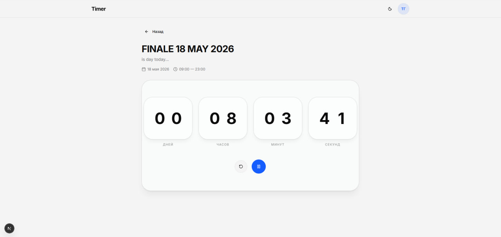

# Timer App

<p align="center">
  Современное приложение для отслеживания событий с обратным отсчётом, выполненное в стиле Apple.
</p>

---

##  Возможности

- 🔐 **Авторизация** — регистрация и вход с bcrypt хешированием паролей
- 📅 **Управление событиями** — создание, просмотр, редактирование и удаление
- ⏱️ **Обратный отсчёт** — анимированные цифры с плавными переходами
- 🌗 **Тёмная и светлая тема** — переключение в один клик
- 📱 **Адаптивный дизайн** — mobile-first подход, touch targets 44px+
-  **Apple-style дизайн** — glassmorphism, мягкие тени, Inter шрифт

## 📸 Скриншоты

### Дашборд

<p align="center">
  
</p>

Список событий с карточками, кнопка создания нового события, переключатель темы.

### Таймер события

<p align="center">
  
</p>

Обратный отсчёт до события с анимированными цифрами и элементами управления.

## 🛠 Стек технологий

| Категория | Технологии |
|-----------|-----------|
| **Framework** | Next.js 16 (App Router) |
| **Language** | TypeScript |
| **Styling** | Tailwind CSS v4 + shadcn/ui |
| **Database** | SQLite + Prisma ORM |
| **Auth** | NextAuth.js (Credentials) |
| **Animations** | Framer Motion |
| **Icons** | Lucide React |
| **Themes** | next-themes |
| **Notifications** | Sonner |

## 🚀 Быстрый старт

### 1. Установка зависимостей

```bash
cd my-timer
npm install
```

### 2. Настройка окружения

Скопируйте `.env.example` в `.env`:

```bash
cp .env.example .env
```

Или создайте `.env` вручную:

```env
DATABASE_URL="file:./dev.db"
NEXTAUTH_SECRET="your-secret-key"
NEXTAUTH_URL="http://localhost:3000"
```

Генерация секрета:
```bash
node -e "console.log(require('crypto').randomBytes(32).toString('hex'))"
```

### 3. Миграции базы данных

```bash
npx prisma generate
npx prisma migrate dev
```

### 4. Запуск

```bash
npm run dev
```

Откройте [http://localhost:3000](http://localhost:3000)

## 📦 Скрипты

| Команда | Описание |
|---------|----------|
| `npm run dev` | Запуск в режиме разработки |
| `npm run build` | Сборка для продакшена |
| `npm run start` | Запуск собранного приложения |
| `npm run lint` | Проверка кода ESLint |

## 📁 Структура проекта

```
my-timer/
├── app/
│   ├── (dashboard)/
│   │   ├── event/[id]/page.tsx   # Страница таймера
│   │   ├── layout.tsx             # Layout дашборда
│   │   └── page.tsx               # Список событий
│   ├── api/
│   │   ├── auth/                  # NextAuth + регистрация
│   │   └── events/                # CRUD события
│   ├── login/page.tsx             # Авторизация
│   ├── register/page.tsx          # Регистрация
│   ├── layout.tsx                 # Root layout
│   └── globals.css                # Глобальные стили
├── components/
│   ├── events/                    # EventCard, CreateEventDialog
│   ├── layout/                    # Header, ThemeToggle
│   ├── providers/                 # SessionProvider, ThemeProvider
│   ├── timer/                     # TimerDisplay, AnimatedDigit
│   └── ui/                        # shadcn/ui компоненты
├── lib/
│   ├── auth/                      # NextAuth config
│   ├── services/                  # EventService
│   ├── prisma.ts                  # Prisma client
│   └── utils.ts                   # cn() helper
├── prisma/
│   └── schema.prisma              # Модели БД
└── middleware.ts                  # Защита роутов
```

## 🎨 Дизайн-система

### Цветовая палитра

| Тема | Фон | Карточки | Акцент |
|------|-----|----------|--------|
| **Light** | `#F5F5F7` | `#FFFFFF` | `#007AFF` |
| **Dark** | `#000000` | `#1D1D1F` | `#007AFF` |

### Типографика

- **Шрифт:** Inter (аналог San Francisco)
- **Заголовки:** `font-bold tracking-tight`
- **Подписи:** `uppercase tracking-widest`

### Компоненты

- **Скругления:** `rounded-2xl` (16px), `rounded-3xl` (24px), `rounded-full`
- **Тени:** мягкие `shadow-lg shadow-black/5`
- **Glassmorphism:** `backdrop-blur-xl bg-card/80`
- **Touch targets:** минимум 44px (Apple HIG)

## 🔒 Безопасность

- Пароли хешируются через `bcrypt` (salt rounds: 12)
- Сессии через JWT с `NEXTAUTH_SECRET`
- Все запросы к событиям проверяют `session.user.id`
- Middleware защищает роуты от неавторизованных пользователей
